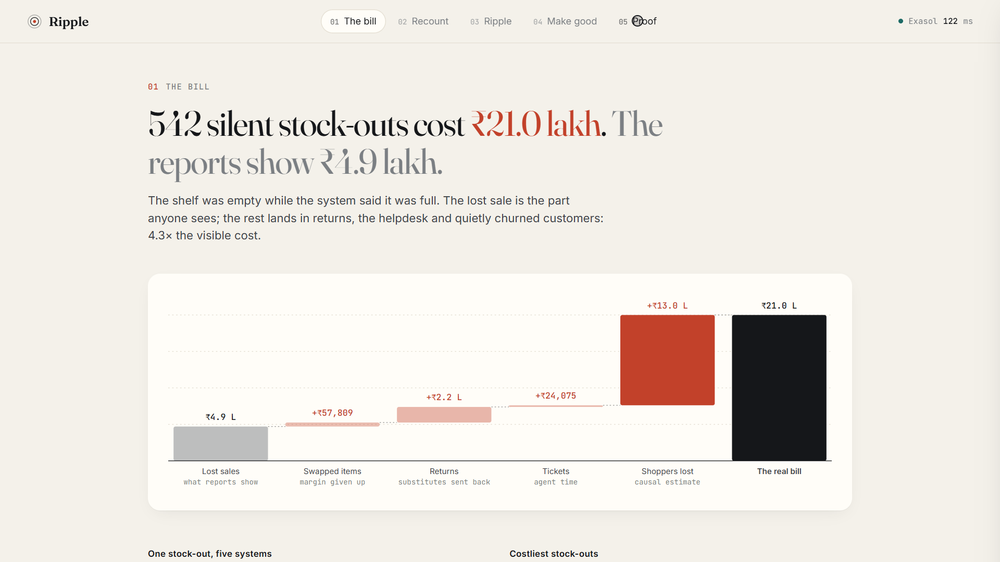

# Ripple

**The full bill of every stock-out.** Ripple runs on Exasol Personal. It
catches *phantom* stock-outs (the system says in stock, the shelf is empty)
about a day and a half after they start, two weeks before the stock record
would be corrected. It then follows every affected shopper, merged across
duplicate accounts, through the substitution, the return, the angry ticket and
the quiet exit, and prices each step with a receipt.

> A stock-out is not one lost sale. On our demo retailer, the lost-sales view
> says **₹4.9 lakh**. Ripple's ledger says **₹21.0 lakh**: 4.3 times as much,
> spread across three systems that never talk to each other.

Track 2 of the Exasol hackathon (Customers, Channels & Demand) lists four
problems. Ripple treats them as one causal chain, because in real life they
are: a stock-out found too late becomes a return that erodes margin, then a
churn signal sitting in a support ticket, written by a customer each system
sees differently.



## Submission materials

| | |
|---|---|
| Demo video (3 min) | [Watch on Google Drive](https://drive.google.com/file/d/1Jh0X1C66Yqbr7MeSmww0IqxhV3cPcJwZ/view?usp=sharing) |
| Pitch deck | [docs/Ripple_pitch_deck.pdf](docs/Ripple_pitch_deck.pdf) |
| Run and deployment guide | [docs/RUN_GUIDE.md](docs/RUN_GUIDE.md) |
| How it works | [docs/METHOD.md](docs/METHOD.md) |
| Benchmarks | [docs/BENCHMARK.md](docs/BENCHMARK.md) |
| Licence | [MIT](LICENSE) |

Team: Debi Prasad Samal, Naveen Kumar, Nekita Saras Dhanabal.

## For evaluators: two minutes

| Criterion | Where to look | What it shows |
|---|---|---|
| Innovation & impact (25%) | [The problem](#the-problem), [Why this is not another dashboard](#why-this-is-not-another-dashboard) | All four Track 2 problems treated as one chain, priced in rupees, with a recount list and make-good offers that act on it |
| Effective use of Exasol (25%) | [How Ripple uses Exasol Personal](#how-ripple-uses-exasol-personal) | Python SET UDFs, a Lua script, in-database entity resolution and causal SQL; 5.8M order lines on a laptop |
| Technical excellence (20%) | [Results](#results-demo-world-seed-42), [docs/METHOD.md](docs/METHOD.md) | Every engine scored against an answer key, beating the textbook baselines, with a stress test and published-research grounding |
| Design & UX (15%) | the app (`python -m ripple.app`) or the demo video | One story per screen: the bill, what to count, who was hit, who to make good, and the proof |
| Docs & reproducibility (10%) | [docs/RUN_GUIDE.md](docs/RUN_GUIDE.md) | One command rebuilds everything from a seed |
| Open source (5%) | [LICENSE](LICENSE) | MIT, synthetic data, no external services |

**In one sentence:** a shelf the system thinks is full but is actually empty
costs far more than the lost sale, and Ripple finds it in a day and a half,
follows every affected customer across five systems, and proves each number.

---

## The problem

**Who has it:** quick-commerce and omnichannel grocers. Their dark stores
promise ten-minute delivery from inventory that is wrong more often than anyone
admits.

**Why it matters:**

* Inventory distortion costs retail about **$1.7 trillion a year**, and
  out-of-stocks account for about $1.2 trillion of that
  ([IHL Group](https://www.ihlservices.com/product/fixing-inventory-distortion-whos-winning-whos-failing-whats-working/)).
* **Two in three store stock records are wrong.** About 65% of 370,000
  SKU-store records in a US chain
  ([DeHoratius & Raman 2008](https://ideas.repec.org/a/inm/ormnsc/v54y2008i4p627-641.html)),
  and 64.7% of 150,000 counts at a UK grocer in 2025
  ([arXiv 2506.05357](https://arxiv.org/pdf/2506.05357)), where a targeted
  audit lifted sales 11.2%. *Phantom inventory* never raises a stock-out
  alert, because the system believes the shelf is full, and it can cost up to
  4% of revenue ([Farias, Li & Peng 2024](https://arxiv.org/pdf/2006.13126)).
* **It hits quick commerce right now.** In October 2026 Bernstein found
  in-stock rates of 94.4% at Blinkit and 82.5% at Zepto across 150 SKUs, with
  Zepto losing 11 points through the day
  ([via Ascendants](https://ascendants.in/?p=34772)).
* **The customer cost is as big as the lost sale.** Stock-outs cut a
  customer's later spending by about as much as the sale itself
  ([Anderson, Fitzsimons & Simester 2006](https://www.kellogg.northwestern.edu/faculty/anderson_e/htm/personalpage_files/Papers/Measuring_and_Mitigating_the_Costs_of_Stockouts.pdf)).
* Shoppers return about **16% of what they buy**, around $850B in the US in 2025
  ([NRF via SupplyChain247](https://www.supplychain247.com/article/2025-retail-returns-hit-850-billion)).
* **Tickets undercount the damage.** Only about 1 in 26 unhappy customers
  complains ([TARP](https://customerthink.com/improving_government_by_solving_complaints_is_good_solving_the_silent_complaints_is_better/)),
  so the shoppers most likely to leave quietly never reach the helpdesk.

**What existing tools miss:** each tool sees one system. Demand planners
see stock records, not the customer saying "app shows in stock but never
delivers". Returns platforms record "not as expected", not "this was a
substitute for an item we didn't have". Helpdesk AI scores tickets, not people,
so it can't see that the same shopper also had a missing item under another
email. The cost of a stock-out ends up split across systems and is never added
up.

## What Ripple does

1. **Detects phantom stock-outs early.** A Bayesian filter for each SKU in each
   store reads four systems at once: POS sales, order-management short picks,
   picker exception logs and customer tickets. It calibrates itself from the
   retailer's own past cycle counts.
2. **Resolves who the customer really is.** Accounts are merged across app,
   web, loyalty and WhatsApp using contact normalisation, fuzzy names, shared
   phones (with a household guard) and a purchase-basket fingerprint. A Lua
   script closes the graph inside Exasol.
3. **Reads the tickets.** In-database Python UDFs read intent (Hinglish and
   typos included) and work out *which* SKU "the milk" means from what that
   person just ordered.
4. **Measures the churn a stock-out causes, not the churn that follows it.**
   Phantoms strike at random, so they form a natural experiment. Ripple
   compares shoppers who hit one with matched shoppers at the same store who did
   not, the same week.
5. **Writes the ledger.** Every rupee is a receipt pointing at an order line,
   a return, a ticket or a person.
6. **Tells each store what to count tomorrow,** ranked by expected money saved
   before the next scheduled count, not by probability alone.
7. **Makes good with the silent shoppers.** It ranks the people a phantom hit
   who never wrote in by the money at stake, and drafts one small, concrete
   offer each, following published field evidence on what recovery works.

## Why this is not another dashboard

* **Measured accuracy.** The simulator writes an answer key that Ripple never
  reads. Every number below is scored against it, live, on the Proof tab.
* **It beats the textbook baselines.** The classic "N zero-sales days" rule
  (Kang & Gershwin), even with the best N picked in hindsight, catches 49% of
  phantoms after 15 days. Ripple catches 91% in a day and a half. With the
  same budget of three counts per store per day, Ripple's recount list saves
  2.8× what "longest silence first" saves and 6.4× random counts.
* **It doesn't need customers to complain.** Grounded in published rates, only
  4% of affected shoppers write in. A stress sweep from 2% to 25% keeps
  detection between 87% and 91%: short picks and picker logs carry it.
* **An ablation that shows why joining silos matters.** Sales data alone
  catches 65% of phantoms, eight days late. Adding short picks and picker logs
  takes it to 91% in a day and a half.
* **A causal estimate, not a correlation.** Shoppers who hit a stock-out
  differ from those who don't (Anderson, Fitzsimons & Simester show frequent
  buyers hit the most). The matched design removes that, and the Proof tab
  checks the estimate against the true effect.
* **It acts, not just reports.** Every rupee is a receipt, every store gets a
  recount list, and the silent shoppers get a make-good offer designed from
  field experiments on what recovery works.
* **Self-calibration.** The detector learns its emission rates from cycle
  counts the retailer already has.

## Results (demo world, seed 42)

12 dark stores · 267 SKUs · 40,000 shoppers with 70,107 accounts · 120 days ·
263k orders · 834k order lines · 7.0k tickets · 504 injected phantom stock-outs ·
4% of affected shoppers complain

| Engine | Metric | Result |
|---|---|---|
| Phantom detector, all four systems | stock-outs caught / alert precision | **90.7%** / 86.2% |
| | days from empty shelf to alert | **1.6** |
| | days before the stock record would be corrected | **14.2** |
| | day-level AUC | 0.989 |
| Detector, POS sales only | caught / days to alert | 65.5% / 8.0 |
| Zero-sales rule (best N = 17, hindsight) | caught / precision / days to alert | 49.4% / 81.9% / 15.0 |
| Recount list, 3 counts per store per day | rupees saved: Ripple / longest silence / random | **₹31.5 L** / ₹11.3 L / ₹4.9 L |
| Identity graph | merged pairs correct (precision) / recall | **99.9%** / 83.0% |
| | 70,107 accounts resolved to | 44,541 people (true: 40,000) |
| Ticket reader | intent accuracy (8 intents) | **96.3%** |
| | right shopper (of linked tickets) / exact SKU on complaints | 99.0% / 84.8% |
| Causal churn | lift in lost-shopper rate after a missing item | **+4.6 pts ± 1.5** (true effect +12.2) |
| Make-good list | silent shoppers listed / credit / expected margin won back | 2,004 / ₹1.3 L / ₹1.9 L |
| | true churn rate, listed vs other silent shoppers | 31.8% vs 22.8% |
| Ledger | billed lines a real phantom broke / real ones billed | 98.6% / 98.7% |
| | total bill vs. lost-sale view | **₹21.0 L vs ₹4.9 L (4.3×)** |

Complaint-rate stress test (each rate is a fresh world, same seed):

| Shoppers who write in | 2% | 4% | 10% | 25% |
|---|---|---|---|---|
| Phantoms caught, all systems | 86.8% | 90.7% | 91.1% | 86.7% |
| Days to alert | 1.7 | 1.6 | 1.9 | 1.8 |
| Phantoms caught, sales only | 60.9% | 65.5% | 66.3% | 59.7% |

**At scale** (30 stores, 200k shoppers, 180 days, 5.8M order lines, about 12M rows
in all) on the same 8 GB laptop: the load takes 32 s and the engines about 5½
minutes, most of it the per-SKU-day filter. The detector catches 92.0% of 2,575
phantoms in 1.3 days at 89.8% precision, identity merges stay 99.8% correct,
and the bill is ₹1.46 Cr against a ₹25 L lost-sale view. Full numbers are in
[docs/BENCHMARK.md](docs/BENCHMARK.md).

The causal estimate is conservative on purpose. Ripple only sees orders, so a
shopper who leaves late in the window looks like one who is pausing. The bill
understates the churn cost rather than inflating it. After a swapped item the
estimate is close to zero (+0.2 ± 1.4 pts, true +7.8), so swaps are billed for
their margin and returns but add almost no churn cost. See
[docs/METHOD.md](docs/METHOD.md), which also compares every simulator setting
with published numbers and lists related work.

## How Ripple uses Exasol Personal

Everything after CSV generation happens inside the database:

| Exasol feature | Where |
|---|---|
| Bulk `IMPORT` over HTTP transport | loading ~2M rows in about 7 s ([ripple/load.py](ripple/load.py)) |
| **Python SET UDF** with `GROUP BY` + `ORDER BY`, one HMM filter per SKU-store group, three ablation variants per pass | [sql/40_detector.sql](sql/40_detector.sql) |
| **Python scalar UDFs** emitting multiple columns: ticket intent and fuzzy product matching | [sql/30_tickets.sql](sql/30_tickets.sql) |
| **Lua script** running label propagation to a fixed point with `MERGE` | [sql/20_identity.sql](sql/20_identity.sql) |
| `EDIT_DISTANCE`, `SOUNDEX`, `REGEXP_*` for entity resolution in SQL | [sql/20_identity.sql](sql/20_identity.sql) |
| Window functions for gaps-and-islands episodes, trailing demand and traffic indices | [sql/40_detector.sql](sql/40_detector.sql) |
| Stacked difference-in-differences in plain SQL | [sql/50_causal.sql](sql/50_causal.sql) |
| Mann-Whitney AUC, baseline policies and the make-good ranking in SQL | [sql/95_baselines.sql](sql/95_baselines.sql), [sql/80_makegood.sql](sql/80_makegood.sql) |
| Live interactive queries behind every view (the app shows Exasol's response time) | [ripple/app.py](ripple/app.py) |

Stage timings land in `RIPPLE.RUN_TIMINGS` and on the Proof tab.

## Quick start

Full instructions for Windows (WSL), macOS and Linux are in
[docs/RUN_GUIDE.md](docs/RUN_GUIDE.md).

```bash
# 1. Exasol Personal
curl https://downloads.exasol.com/exasol-personal/installer.sh | sh
exasol install local
exasol slc install PYTHON3

# 2. Ripple
python -m pip install -r requirements.txt
python -m ripple.build          # generate, load, run every engine (about 2 min)
python -m ripple.app            # http://localhost:8765
```

## Repository layout

```
generator/      seeded synthetic world (catalogue, shoppers, day-by-day simulation, ticket text)
sql/            the engines, run in order by ripple.pipeline
  00_schema     source systems (RIPPLE_RAW) and answer key (RIPPLE_GT)
  20_identity   normalise, block, score, Lua label propagation
  30_tickets    owner linking, intent UDF, product-matching UDF
  40_detector   signal fusion, self-calibration, HMM filter UDF, episodes
  50_causal     matched natural-experiment churn estimate
  60_ledger     receipts and the bill per episode
  70_recount    morning recount list by expected saving
  80_makegood   ranked offers for silent shoppers a phantom hit
  90_eval       scores every engine against RIPPLE_GT
  95_baselines  zero-sales rule, AUC, recount policies, make-good targeting
ripple/         db connection, loader, pipeline runner, one-command build, stress sweep, web API
web/            single-page app (plain JS, hand-drawn SVG)
docs/           METHOD.md, RUN_GUIDE.md, BENCHMARK.md, DEMO_SCRIPT.md
```

## Data

All data is synthetic, generated by code in this repository. Brand, store and
customer names are invented. No employer or proprietary data is used.
Real-world figures quoted above come from the public sources linked beside
them.

## Team

Debi Prasad Samal, Naveen Kumar and Nekita Saras Dhanabal.

## Licence

[MIT](LICENSE)
